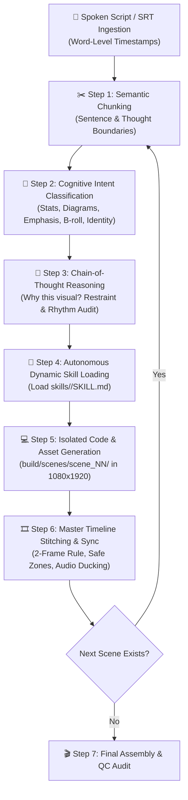

# ai-video-director

## Overview

এই স্কিল **Roberto Nickson (RPN)** ও **Kallaway**-এর স্টাইলে প্রিমিয়াম ক্রিয়েটর-গ্রেড এডিট তৈরি করে — সম্পূর্ণভাবে কোডের মাধ্যমে, কোনো গ্রাফিক্যাল এডিটর ছাড়া। এটি একটি **9-স্টেপ, ফুলি-অটোমেটেড পাইপলাইন** যা:

- Raw footage থেকে শুরু করে publication-ready 9:16 ভার্টিক্যাল ভিডিও তৈরি করে।
- স্ক্রিপ্টের **প্রতিটি শব্দের** সাথে সিঙ্ক্রোনাইজড ভিজ্যুয়াল ইফেক্ট প্রয়োগ করে (sync map)।
- SRT ফাইল উপস্থিত থাকলে স্বয়ংক্রিয়ভাবে ট্রান্সক্রিপশন স্কিপ করে — সময় ও API কোটা বাঁচায়।
- বাংলা, ইংরেজি ও অন্যান্য ভাষার কনটেন্ট সমানভাবে সাপোর্ট করে।
- ক্যাপশন, কালার গ্রেড, জুম, সাউন্ড ডিজাইন ও মোশন গ্রাফিক্স — সব **একটি পাইপলাইনে** সম্পন্ন করে।
- **মাত্র একবার** থামে: প্রিভিউ অনুমোদনের জন্য।

এই স্কিলের প্রধান দর্শন: **"No timeline. Only code."** — প্রতিটি কাট, ট্রানজিশন, ইফেক্ট ও টাইমিং একটি নির্ভুল, পুনরাবৃত্তিযোগ্য কোডবেসে এনকোড করা থাকে।

---

## The 9-Step Pipeline (সম্পূর্ণ কর্মপ্রবাহ)

### STEP 1: TRANSCRIPTION & BEST TAKE SELECTION

#### SRT Policy (সর্বোচ্চ অগ্রাধিকার)

**যদি `srt/` ফোল্ডারে `.srt` ফাইল থাকে:**

1. প্রতিটি SRT ফাইলের নামকে ক্লিপের নামের সাথে মিলিয়ে দেখো।
   - উদাহরণ: `srt/take_3.srt` → ক্লিপ `take_3.mp4`
   - ফাইল নাম হুবহু না মিললে fuzzy match করো (prefix/suffix trim)।
2. মিলে যাওয়া SRT ফাইল থেকে **word-level timestamps** সরাসরি পড়ো।
3. `npx hyperframes transcribe` কমান্ড একদম কল করো না।
4. বাংলা বা অন্য non-ASCII টেক্সট সরাসরি SRT থেকে পড়ো — কোনো transliteration করো না।

**যদি `srt/` ফোল্ডার না থাকে বা ফোল্ডার খালি থাকে:**

```bash
npx hyperframes transcribe --input clips/ --output srt/ --word-level true --language auto
```

- `--word-level true` ফ্ল্যাগ অবশ্যই দাও, word-level timestamps ছাড়া sync map কাজ করবে না।
- `--language auto` দিলে ভাষা স্বয়ংক্রিয় শনাক্ত হয়; বাংলার জন্য `--language bn` ব্যবহার করো।

#### Best Take Selection Algorithm

```
FOR each line in script:
  1. সর্বশেষ (সবচেয়ে বড় টেক নম্বর) take দিয়ে শুরু করো।
  2. নিচের যেকোনো সমস্যা থাকলে → আগের টেকে যাও:
     a. stumble: কোনো শব্দ দুবার বলা হয়েছে বা থেমে থেমে বলা হয়েছে।
     b. clipped word: শব্দের শুরু বা শেষ কাটা গেছে।
     c. flat energy: monotone, উৎসাহ নেই — সর্বশেষ বিকল্প হিসেবে বিবেচনা করো।
  3. কোনো টেকেই সন্তোষজনক না হলে → সবচেয়ে কম সমস্যাযুক্ত টেকটি নাও।
```

#### takes.md ফরম্যাট

প্রতিটি নির্বাচিত লাইনের জন্য `takes.md` এ নিচের ফরম্যাটে লেখো:

```markdown
| Line | Script Text | Selected Take | Start | End | Reason |
|------|-------------|---------------|-------|-----|--------|
| 1 | "এটা সত্যিই কাজ করে" | take_3 | 00:12.4 | 00:15.1 | শেষ সম্পূর্ণ টেক, ভালো এনার্জি |
| 2 | "আমি অবাক হয়েছি" | take_2 | 00:08.7 | 00:11.2 | take_3 তে stumble ছিল |
```

- প্রতিটি সিদ্ধান্তের কারণ লেখা বাধ্যতামূলক।
- ফাইল পাথ পূর্ণ রাখো।

---

### STEP 2: TIGHT CUT

#### বিরতি কাটার নিয়ম

- **০.১৫ সেকেন্ডের বেশি** যেকোনো নীরবতা কাটো।
- শ্বাস-প্রশ্বাসের বিরতি (breath pause): ০.১৫s পর্যন্ত রাখো — এটা স্বাভাবিক শোনায়।
- একটি শব্দের মাঝখানে (mid-word) কাট করা **সম্পূর্ণ নিষেধ**।
- শব্দের শেষ থেকে পরের শব্দের শুরু পর্যন্ত গ্যাপ পরিমাপ করো।

#### 2-Frame Handle Rule

প্রতিটি কাটে:
- **In-point**: শব্দ শুরুর ঠিক **২ ফ্রেম আগে** (30fps = ~66ms)।
- **Out-point**: শব্দ শেষের ঠিক **২ ফ্রেম পরে**।
- এটি abrupt pop শব্দ এড়ায় এবং কাট স্মুথ রাখে।

#### ffmpeg Concat Script Template

```bash
# silence_remover.py দিয়ে প্রতিটি সেগমেন্ট নির্ধারণ করো
# তারপর ffmpeg concat demuxer দিয়ে জোড়া লাগাও:
ffmpeg -f concat -safe 0 -i segments.txt -c copy tight_cut.mp4
```

---

### STEP 3: COLOUR GRADE

#### গ্রেডিং প্যারামিটার (ffmpeg filtergraph)

```
curves=
  r='0/0 0.1/0.08 0.5/0.55 0.9/0.95 1/1':   ← S-curve (cinematic contrast)
  g='0/0 0.1/0.09 0.5/0.52 0.9/0.93 1/1':
  b='0/0 0.1/0.12 0.5/0.48 0.9/0.88 1/1',    ← cool shadows

colorbalance=
  rs=0.03:gs=-0.01:bs=-0.04:                  ← warm highlights (skintone)
  rm=0.01:gm=0:bm=-0.02:                      ← neutral mids
  rl=-0.02:gl=-0.01:bl=0.04,                  ← cool shadows

vignette=PI/5:                                 ← soft vignette (18% corner darkening)

noise=alls=3:allf=t+u                          ← film grain (temporal+uniform, strength 3)
```

#### Ungraded Copy সংরক্ষণ

```bash
cp tight_cut.mp4 output/ungraded.mp4
```

- এই কপি **STEP 6-এ** "colour grading" বিটে reveal করার জন্য ব্যবহার হবে।
- কখনো overwrite করো না।

---

### STEP 4: SMART ZOOMS

#### Face Tracking

```bash
npx hyperframes track-face \
  --input graded.mp4 \
  --output face_data.json \
  --target eyes \
  --smoothing 0.85
```

- `--target eyes`: চোখের কেন্দ্রবিন্দুতে ফোকাস রাখো।
- `--smoothing 0.85`: হঠাৎ ঝাঁকুনি এড়াতে উচ্চ স্মুথিং ব্যবহার করো।

#### Zoom Levels ও নিয়ম

| Condition | Zoom Level | Duration |
|-----------|-----------|----------|
| Normal talking head | 100% | Default |
| Key phrase / emphasis | 120% | ≥ 1.5s segment |
| Source is 1080p | Max 115% | — |
| Source is 4K | Max 130% | — |

- ১০০% ও ১২০% **alternate** করো — একটানা একই লেভেলে থাকো না।
- জুম ট্রানজিশন: `ease-in-out` curve, ০.৩s duration।
- ফেস সেন্টার থেকে ২০% এর বেশি সরে গেলে re-center করো।

#### ffmpeg Zoom Implementation

```bash
# face_data.json থেকে per-frame zoom ও pan ক্যালকুলেট করে
# zoompan filter দিয়ে প্রয়োগ করো:
ffmpeg -i graded.mp4 \
  -vf "zoompan=z='zoom_expr':x='x_expr':y='y_expr':d=1:s=1080x1920" \
  zoomed.mp4
```

---

### STEP 5: CAPTIONS & DESIGN

#### Caption Timing

- প্রতিটি ক্যাপশন গ্রুপে **২–৪ শব্দ** রাখো।
- প্রতিটি শব্দ তার নিজস্ব word-level timestamp অনুযায়ী **individually** হাইলাইট হবে।
- **Fade-in**: ৮০ms।
- **Fade-out**: পরবর্তী ক্যাপশনের শুরুর ঠিক আগে।

#### Design Spec

| Property | Value |
|----------|-------|
| Font | Montserrat ExtraBold / Noto Sans Bengali Bold |
| Font size | 72px (baseline) |
| Text color | #FFFFFF |
| Active keyword color | #D97757 (warm orange) |
| Background | Semi-transparent pill: rgba(0,0,0,0.45), border-radius 16px |
| Stroke | 3px #000000 (readability) |
| Shadow | 0px 4px 12px rgba(0,0,0,0.6) |

#### Safe Zone (9:16 = 1080×1920)

```
Top margin:    220px   ← ইন্সটাগ্রাম UI এড়াতে
Bottom margin: 420px   ← TikTok / Reels CTA বাটন এড়াতে
Left margin:   60px
Right margin:  140px   ← TikTok sidebar icons এড়াতে
```

**Caption placement**: ফ্রেমের উল্লম্ব কেন্দ্রের সামান্য নিচে (y ≈ 55% of height = ~1056px from top)। Safe zone-এর মধ্যে থাকা বাধ্যতামূলক।

#### ffmpeg Subtitle Overlay

```bash
ffmpeg -i zoomed.mp4 \
  -vf "subtitles=captions.ass:force_style='FontName=Montserrat,FontSize=72,...'" \
  captioned.mp4
```

- ASS ফরম্যাট ব্যবহার করো — SRT-এর চেয়ে বেশি স্টাইলিং কন্ট্রোল দেয়।
- প্রতিটি active word-এর জন্য আলাদা `\c&H5777D9&` (BGR: #D97757) কালার কোড সেট করো।

---

### STEP 6: SYNC MAP & AI DIRECTOR MODES (সবচেয়ে ক্রিটিক্যাল স্টেপ)

বাস্তব জীবনে কোনো ক্রিয়েটর ভিডিওতে মুখে "এখন কাট করো", "এখন জুম করো" বলে না। তাই এই স্কিলটি **দুটি শক্তিশালী মোডে** কাজ করে:

```
┌────────────────────────────────────────────────────────────────────────┐
│                        SYNC MAP OPERATING MODES                        │
├─────────────────────────────────────────┬──────────────────────────────┤
│ MODE 1: Semantic Director (DEFAULT)     │ MODE 2: Meta / Demo Mode     │
│ ক্রিয়েটর স্বাভাবিক কথা বলবে। এআই স্ক্রিপ্ট ও   │ ক্রিয়েটর মুখে ইফেক্টের নাম বলে      │
│ কনটেক্সট বুঝে স্বয়ংক্রিয়ভাবে কাট, জুম ও       │ ডেমো রিল তৈরি করে (আর্টিকেলের        │
│ গ্রাফিক্স তৈরি করবে।                    │ সেলফ-রেফারেন্সিয়াল স্টাইল)।        │
└─────────────────────────────────────────┴──────────────────────────────┘
```

---

#### 🌟 MODE 1: Autonomous Semantic Director & Scene-by-Scene Reasoning Engine (বাস্তব কনটেন্টের জন্য ডিফল্ট)

বাস্তব জীবনে কোনো প্রফেশনাল ক্রিয়েটর ভিডিওতে ক্যামেরার সামনে দাঁড়িয়ে কখনো মুখে "এখন কাট করো", "এখন জুম দাও", "এখন চার্ট দেখাও" বলে না। ক্রিয়েটর স্বাভাবিকভাবে নিজের গল্প, টেকনিক্যাল টপিক, বা ব্যবসার কথা বলে। তাই `ai-video-director`-এর মূল শক্তি হলো তার **Autonomous Context Understanding & Scene-by-Scene Reasoning Engine**।

এই ইঞ্জিনটি একজন অভিজ্ঞ সিনিয়র ভিডিও ডিরেক্টর ও মোশন ডিজাইনারের মতো চিন্তা করে: এটি স্ক্রিপ্ট বা SRT সাবটাইটেলের প্রতিটি বাক্যের পেছনের **অর্থ, ব্যাকরণিক উদ্দেশ্য (Intent), আবেগ (Emotion), সংখ্যা ও টেকনিক্যাল টার্ম** গভীর বুদ্ধিমত্তার সাথে বিশ্লেষণ করে, স্বয়ংক্রিয়ভাবে সংশ্লিষ্ট মোশন স্কিল লোড করে এবং পর পর দৃশ্য অনুযায়ী প্রিমিয়াম অ্যাসেট জেনারেট করে মাস্টার টাইমলাইনে বসায়।



---

### ৫-ধাপের সম্পূর্ণ কগনিটিভ রিজনিং ফ্রেমওয়ার্ক (The 5-Stage Cognitive Framework)

এআই এজেন্ট যখন এই মোডে কাজ করবে, তখন সে কোনো স্টেপ স্কিপ না করে নিচের ৫টি ধাপে ক্রমানুসারে (Sequentially) কাজ করবে:

---

#### ধাপ ১: সিম্যান্টিক চাংকিং ও সিন বিভাজন (Semantic Chunking & Beat Parsing)
- **ইনপুট বিশ্লেষণ:** স্ক্রিপ্ট বা SRT থেকে প্রতিটি স্পোকেন লাইন এবং তার word-level timestamps পড়ে।
- **চাংকিং রুলস:**
  - প্রতিটি পূর্ণচ্ছেদ (বাংলায় `।`, ইংরেজিতে `.`, `?`, `!`) অথবা ০.১৫ সেকেন্ডের স্বাভাবিক ভয়েস পজ একটি স্বতন্ত্র **Scene Unit (Beat)** তৈরি করে।
  - প্রতিটি সিনের নিজস্ব মেটাডাটা থাকবে:
    ```json
    {
      "scene_id": "scene_01",
      "start_time": "00:04.200",
      "end_time": "00:07.850",
      "duration_sec": 3.65,
      "text": "গত এক বছরে আমাদের কনভার্সন রেট ১২% থেকে বেড়ে ৪৭% হয়েছে।",
      "active_keywords": ["১২%", "৪৭%", "কনভার্সন রেট"]
    }
    ```

---

#### ধাপ ২: ইন্টেন্ট ও এন্টিটি ক্লাসিফিকেশন (Intent & Entity Taxonomy)
এআই প্রতিটি সিনের টেক্সট পড়ে নিচের ১০টি স্ট্যান্ডার্ড ক্যাটাগরির সাথে মেলাবে:

| ইন্টেন্ট ক্যাটাগরি | শনাক্তকারী শব্দ ও ব্যাকরণিক প্যাটার্ন | টার্গেট মোশন স্কিল | আউটপুট ধরন |
|-------------------|--------------------------------------|-------------------|------------|
| **1. METRIC_STAT** | সংখ্যা, %, টাকা, ডলার, বৃদ্ধি, হ্রাস, অনুপাত | `skills/chart-animation` | ফ্রেম-ড্রিভেন বার/লাইন চার্ট, কাউন্টার টিকার |
| **2. SYSTEM_FLOW** | প্রসেস, স্টেপ, আর্কিটেকচার, পাইপলাইন, ফানেল | `skills/diagram-animation` | কানেক্টিং নোড, ভেক্টর ফ্লোচার্ট, ডাটা ফ্লো |
| **3. PUNCHLINE_EMPHASIS** | মূল সারমর্ম, সিক্রেট ট্রিক, সতর্কবার্তা, পাঞ্চলাইন | `skills/kinetic-typography` | হাই-ইমপ্যাক্ট টাইপোগ্রাফি, জাম্প কাট + পুশ জুম |
| **4. VECTOR_ACCENT** | নির্দিষ্ট শব্দ হাইলাইট, বৃত্ত দিয়ে দাগ, আন্ডারলাইন | `skills/svg-animation` | হ্যান্ড-ড্রন পাথ ড্রয়িং, সার্কেল, হাইলাইটার |
| **5. STRUCTURED_DATA** | একাধিক পয়েন্ট, তুলনামূলক লিস্ট, ফিচার লিস্ট | `skills/animated-infographic` | ইনফোগ্রাফিক কার্ড, স্প্লিট কম্প্যারিজম |
| **6. NARRATIVE_BROLL** | কাজের গল্প, উদাহরণ, স্ক্রিনশট, বাস্তব পরিস্থিতি | `skills/talking-head-b-roll` | ক্যানভাস জেনারেটিভ বি-রোল, Treatment B/C |
| **7. SPEAKER_IDENTITY** | নাম, পরিচয়, পদবী, সোশ্যাল হ্যান্ডেল, কল টু অ্যাকশন | `skills/lower-thirds` | ট্রান্সপারেন্ট ব্রডকাস্ট লোয়ার থার্ড |
| **8. BRAND_MOMENT** | টুল, কোম্পানি, সফটওয়্যার বা চ্যানেল লোগো | `skills/logo-animation` | ভেক্টর লোগো স্টিং ও রিভিল |
| **9. MICRO_INTERACTION** | সাকসেস স্টেট, সাবস্ক্রাইব বাটন, বেল আইকন | `skills/lottie-animation` | লাইটওয়েট লটি ভেক্টর অ্যানিমেশন |
| **10. ATMOSPHERE_MOOD**| ট্রানজিশন, মুড পরিবর্তন, ব্যাকগ্রাউন্ড ডেপথ | `skills/motion-background` | পার্টিকেল ড্রাইভেন মোশন ব্যাকগ্রাউন্ড |

---

#### ধাপ ৩: চেইন-অফ-থট রিজনিং ও রেস্ট্রেইন্ট অডিট (Chain-of-Thought & Restraint Audit)
এআই কোনো কোড লেখার আগে অবশ্যই একটি অভ্যন্তরীণ **Reasoning Log** প্রস্তুত করবে। এই লগে নিচের প্রশ্নগুলোর উত্তর বাধ্যতামূলক:
1. **কেন এই ভিজ্যুয়াল?** বক্তার কথাটির গভীরতম অর্থ কী? কোনো গ্রাফিক না দিয়ে শুধু ফেস-ক্যাম রাখলে কি বেশি শক্তিশালী হতো?
2. **রেস্ট্রেইন্ট চেক (The 2–4s Rhythm Rule):**
   - আগের সিনে কি কোনো ভারী মোশন গ্রাফিক্স ছিল? থাকলে এই সিনে শুধুমাত্র ক্লিন ক্যাপশন ও ফেস-কাট রাখো।
   - কখনোই পরপর দুটি সিনে ফুল-স্ক্রিন মোশন গ্রাফিক্স দেওয়া যাবে না।
3. **সেফ জোন ও ভিউয়ার সাইকোলজি:** দর্শকের চোখ কোন অংশে থাকবে? সাবজেক্টের মুখ যেন ঢাকা না পড়ে।

---

#### ধাপ ৪: স্বয়ংক্রিয় ডায়নামিক স্কিল লোডিং ও সিন কোড জেনারেট (Autonomous Skill Loading & Isolated Generation)
- **স্কিল ডিসকভারি:** সিদ্ধান্ত অনুযায়ী এআই `skills/<target-skill>/SKILL.md` ফাইলটি মেমোরিতে রিড করবে।
- **আইসোলেটেড সিন ফোল্ডার তৈরি:**
  ```
  build/
  └── scenes/
      ├── scene_01_lower_thirds/
      │   ├── index.html
      │   ├── style.css
      │   └── render_spec.json
      ├── scene_02_chart_animation/
      │   ├── chart.svg
      │   └── animation.js
      └── scene_03_svg_accent/
  ```
- **স্ট্যান্ডার্ড ডিজাইন টোকেনস প্রয়োগ:**
  - রেজোলিউশন: ১০৮০×১৯২০ (9:16)
  - কালার প্যালেট: হোয়াইট `#FFFFFF`, ডার্ক ব্যাকগ্রাউন্ড `#141413`, অ্যাকসেন্ট অরেঞ্জ `#D97757`
  - ইজিং: `cubic-bezier(0.16, 1, 0.3, 1)` (expo-out — নো বাউন্স)
  - সেফ জোন: টপ ২২০px, বটম ৪২০px, রাইট ১৪০px, লেফট ৬০px।

---

#### ধাপ ৫: ক্রমানুসারে মাস্টার টাইমলাইন ব্লেন্ডিং ও অডিও সিঙ্ক (Sequential Assembly & Audio Sync)
- প্রতিটি সিনের জেনারেটেড অ্যাসেটকে তার টাইমস্ট্যাম্প অনুযায়ী ffmpeg `filter_complex` অথবা HyperFrames লেয়ার দিয়ে মাস্টার ভিডিওতে কম্পোজিট করা হয়।
- **২-ফ্রেম হ্যান্ডেল রুল:** অডিও ওয়েভফর্মের সাথে মিলিয়ে শব্দের ঠিক ২ ফ্রেম আগে (`-0.066s`) ভিজ্যুয়াল দৃশ্যমান হবে।
- **অটোমেটিক সাউন্ড ডিজাইন:**
  - চার্ট রিভিলে: `assets/sfx/pop.wav` (-14 dBFS)
  - ক্যামেরা পুশ জুমে: `assets/sfx/whoosh.wav` (-12 dBFS)
  - ইমপ্যাক্ট বা জাম্প কাটে: `assets/sfx/click.wav` (-15 dBFS)
  - ব্যাকগ্রাউন্ড মিউজিক ডাকিং: কথা চলাকালীন -২০ dBFS, বিরতিতে -১২ dBFS।
- **স্টিল প্রিভিউ তৈরি:** প্রতিটি সিনের মিডপয়েন্টের একটি স্টিল ইমেজ `output/stills/scene_NN.jpg`-এ সংরক্ষণ করা হয়।

---

### এআই এজেন্টের জন্য স্ট্যান্ডার্ড রিজনিং ফরম্যাট (Mandatory CoT Prompt Template)

এআই এজেন্ট যখন প্রতিটি সিন প্রসেস করবে, তখন তাকে অবশ্যই টার্মিনাল/লগে নিচের ফরম্যাটে নিজের থিংকিং প্রিন্ট করতে হবে:

```markdown
══════════════════════════════════════════════════════════════════════════
🎬 AI DIRECTOR SCENE REASONING ENGINE — SCENE [index]
══════════════════════════════════════════════════════════════════════════
⏱️ TIMECODE:        [start_timestamp] ➔ [end_timestamp] (Duration: [X.Xs])
🗣️ SPOKEN TEXT:     "[সম্পূর্ণ বাংলা বা ইংরেজি বাক্য]"
🎯 INTENT CATEGORY:  [METRIC_STAT / SYSTEM_FLOW / PUNCHLINE / VECTOR_ACCENT / etc.]

🧠 COGNITIVE REASONING & VISUAL STRATEGY:
1. Context Analysis:  [বক্তা এখানে কী ভাব বা বার্তা দিচ্ছেন? দর্শকের কী দেখা প্রয়োজন?]
2. Visual Hypothesis: [এখানে কি ফুল-স্ক্রিন মোশন দরকার নাকি টকিং-হেড ওভারলে?]
3. Restraint Check:   [আগের সিনটি কেমন ছিল? এটি কি ২-৪ সেকেন্ডের রিদম বজায় রাখছে?]
4. Safe Zone Audit:   [মুখের পজিশন কোথায়? গ্রাফিক্স কোন জোনে রাখা নিরাপদ?]

🚀 LOADED SKILL:     skills/[target-skill]/SKILL.md
🎨 ASSET PARAMETERS:
   - Primary Elements: [যেমন: Bar Chart from 12% to 47%]
   - Color Palette:    Primary: #FFFFFF | Accent: #D97757 | Dark: #141413
   - Audio FX Sync:    assets/sfx/[sound.wav] at T - 2 frames

⚙️ GENERATED FILE:    build/scenes/scene_[index]_[slug]/index.html
══════════════════════════════════════════════════════════════════════════
```

---

### বাস্তব উদাহরণের মাধ্যমে সম্পূর্ণ এন্ড-টু-এন্ড রিজনিং ওয়াকথ্রু (Real-World Walkthrough)

ধরা যাক ইউজারের স্ক্রিপ্টটি নিম্নরূপ:

> **স্ক্রিপ্ট:**  
> "হাই, আমি সৌকত। এআই দিয়ে কীভাবে কনটেন্ট বানাতে হয় তা নিয়ে আমরা অনেক দিন ধরে রিসার্চ করছি।  
> একটা সময় আমাদের কনভার্সন রেট ছিল মাত্র ১২%, কিন্তু সিস্টেম অটোমেট করার পর সেটা এক লাফে বেড়ে ৪৭% হয়ে গেছে!  
> পুরো প্রসেসটা কিন্তু একদম সিম্পল: প্রথমে র ফুটেজ যায় এফএফএমপেগে, তারপর সেখান থেকে হাইপারফ্রেমে।  
> এটাই হলো সেই আসল সিক্রেট যা কেউ আপনাকে সহজে বলবে না।"

চলুন দেখি `ai-video-director` কীভাবে প্রতিটি সিন একা একা রিজনিং করে স্কিল লোড করবে:

---

#### 🎬 সিন ১: স্পিকার পরিচিতি
- **টাইমকোড:** `00:00.000 ➔ 00:03.200`
- **স্পোকেন টেক্সট:** "হাই, আমি সৌকত। এআই দিয়ে কীভাবে কনটেন্ট বানাতে হয় তা নিয়ে আমরা অনেক দিন ধরে রিসার্চ করছি।"
- **ইন্টেন্ট ক্লাসিফিকেশন:** `SPEAKER_IDENTITY`
- **এআই রিজনিং:**
  - এটি ভিডিওর হুক ও স্পিকার পরিচিতি। দর্শকের সাথে বিশ্বাসযোগ্যতা তৈরি করতে হবে।
  - ফেস ঢাকা যাবে না। বক্তার চোখ ও মুখ সম্পূর্ণ উন্মুক্ত থাকবে।
  - ফ্রেমের নিচের সেফ জোনে (Y: 1400px) একটি স্বচ্ছ, পরিপাটি মিনিমাল লোয়ার থার্ড দরকার।
- **অটো-লোডেড স্কিল:** `skills/lower-thirds`
- **এক্সিকিউশন:**
  - `skills/lower-thirds/SKILL.md` পরে `build/scenes/scene_01_lower_third/` জেনারেট করে।
  - টেক্সট: "সৌকত | AI Content Systems"
  - ইন-অ্যানিমেশন: ০.৩s বাম থেকে স্লাইড ইন + ৮০ms পরে সাবটাইটেল ফেড-ইন।
  - SFX: খুব সফট `whoosh.wav` (-18dB)।

---

#### 🎬 সিন ২: সংখ্যা ও কনভার্সন মেট্রিক্স
- **টাইমকোড:** `00:03.200 ➔ 00:07.500`
- **স্পোকেন টেক্সট:** "একটা সময় আমাদের কনভার্সন রেট ছিল মাত্র ১২%, কিন্তু সিস্টেম অটোমেট করার পর সেটা এক লাফে বেড়ে ৪৭% হয়ে গেছে!"
- **ইন্টেন্ট ক্লাসিফিকেশন:** `METRIC_STAT`
- **এআই রিজনিং:**
  - এখানে দুটি স্পষ্ট সংখ্যা রয়েছে: `১২%` এবং `৪৭%`। এটি বিশাল অর্জনের গল্প।
  - মুখে বলার চেয়ে চোখে দেখলে ইমপ্যাক্ট ১০ গুণ বেড়ে যায়।
  - অতএব, স্ক্রিনের ডানে অথবা সাবজেক্টের মাথার পেছনে একটি মিনিমাল অ্যানিমেটেড বার চার্ট রেন্ডার করতে হবে, যেখানে প্রথম বারটি ১২%-এ থাকবে এবং দ্বিতীয় বারটি ১২% থেকে অ্যানিমেট হয়ে ৪৭%-এ উঠবে।
- **অটো-লোডেড স্কিল:** `skills/chart-animation`
- **এক্সিকিউশন:**
  - `skills/chart-animation/SKILL.md` থেকে D3/Canvas বার চার্ট টেমপ্লেট নিয়ে কোড জেনারেট।
  - ১২% বার: ডার্ক গ্রে `#333333`, ৪৭% বার: প্রাণবন্ত অ্যাকসেন্ট অরেঞ্জ `#D97757`।
  - অ্যানিমেশন টাইমিং: যখন বক্তা "৪৭%" উচ্চারণ করে ঠিক সেই ফ্রেমটিতে বারটি উর্ধ্বমুখী হয়।
  - SFX: নাম্বার ওঠার সাথে সাথে ক্রিস্প `pop.wav`।

---

#### 🎬 সিন ৩: আর্কিটেকচার ও পাইপলাইন ফ্লো
- **টাইমকোড:** `00:07.500 ➔ 00:11.800`
- **স্পোকেন টেক্সট:** "পুরো প্রসেসটা কিন্তু একদম সিম্পল: প্রথমে র ফুটেজ যায় এফএফএমপেগে, তারপর সেখান থেকে হাইপারফ্রেমে।"
- **ইন্টেন্ট ক্লাসিফিকেশন:** `SYSTEM_FLOW`
- **এআই রিজনিং:**
  - বক্তা একটি টেকনিক্যাল পাইপলাইন বর্ণনা করছে: `Raw Footage` ➔ `ffmpeg` ➔ `HyperFrames`।
  - এটি লিনিয়ার ৩-স্টেপ ফ্লো। একটি ডায়নামিক কানেক্টিং নোড ডায়গ্রাম এখানে সবচেয়ে কার্যকর।
  - আগের সিনে চার্ট ছিল, তাই এখানে স্পিকারের ফেস ১০০% কাট করে ক্যানভাস Treatment C (Cover) অথবা ওভারলে গ্লাস কার্ড দেওয়া যায়।
- **অটো-লোডেড স্কিল:** `skills/diagram-animation`
- **এক্সিকিউশন:**
  - ৩টি নোড: `Raw Video` ➔ `ffmpeg Cutter` ➔ `HyperFrames Engine`।
  - নোডগুলো বাম থেকে ডানে কানেক্টিং লাইন অ্যানিমেশন সহকারে ক্রমানুসারে জ্বলে উঠবে।
  - অ্যাকসেন্ট বর্ডার: `#D97757`।
  - SFX: প্রতি নোড রিভিলে মাইক্রো `click.wav`।

---

#### 🎬 সিন ৪: পাঞ্চলাইন ও আন্ডারলাইন ড্রয়িং
- **টাইমকোড:** `00:11.800 ➔ 00:14.500`
- **স্পোকেন টেক্সট:** "এটাই হলো সেই আসল সিক্রেট যা কেউ আপনাকে সহজে বলবে না।"
- **ইন্টেন্ট ক্লাসিফিকেশন:** `PUNCHLINE_EMPHASIS` + `VECTOR_ACCENT`
- **এআই রিজনিং:**
  - এটি ভিডিওর চূড়ান্ত পাঞ্চলাইন। কোনো জটিল ডায়গ্রাম রাখা যাবে না। ফেস আবার ক্লোজআপে আসবে।
  - ক্যামেরা জুম: ১০০% থেকে ১১৫% ফেস পুশ-ইন (০.৪s ease-out)।
  - "আসল সিক্রেট" শব্দটির নিচে হাত দিয়ে পেন দিয়ে দাগ দেওয়ার মতো একটি হ্যান্ড-ড্রন ভেক্টর আন্ডারলাইন হবে।
- **অটো-লোডেড স্কিল:** `skills/svg-animation`
- **এক্সিকিউশন:**
  - `skills/svg-animation/SKILL.md` অনুযায়ী একটি বাঁকা ভেক্টর পাথ `<path d="M..."/>` তৈরি করা হবে।
  - `stroke-dasharray` এবং `stroke-dashoffset` দিয়ে ০.৩ সেকেন্ডে লাইনটি বাম থেকে ডানে ড্র-অন হবে।
  - কালার: অ্যাকসেন্ট অরেঞ্জ `#D97757`, স্ট্রোক উইডথ: ৪px।
  - SFX: হালকা `whoosh.wav`।

---

এইভাবে সম্পূর্ণ ভিডিওটি শুরু থেকে শেষ পর্যন্ত কোনো ম্যানুয়াল ইন্টারভেনশন ছাড়া স্বয়ংক্রিয়ভাবে একটি সিনেমাটিক মাস্টারপিসে রূপ নেয়।

---

#### 🎬 MODE 2: Meta / Demo Reel Mode (সেলফ-রেফারেন্সিয়াল ডেমো রিলের জন্য)

যখন ক্রিয়েটর ইচ্ছাকৃতভাবে এডিটিং নিয়ে কোনো ডেমো ভিডিও বানায় (যেখানে মুখে ইফেক্টের নাম বলা হয়), তখন নিচের হার্ডকোডেড Sync Map কার্যকর হবে:

> **গুরুত্বপূর্ণ নিয়ম**: ২–৪ সেকেন্ড ব্যবধানে সবসময় কিছু একটা পরিবর্তন হবে। কিন্তু **একই সময়ে দুটো ইফেক্ট কখনো না** (একটি শেষ হওয়ার পর পরেরটি শুরু হবে)।

#### সম্পূর্ণ Beat-by-Beat Sync Map (Meta Mode)

---

**[ভিডিও শুরু → "captions" শব্দ পর্যন্ত]**
- ক্যাপশন: **বন্ধ** (caption layer invisible)।
- ফ্রেমের উপরে টাইটেল কার্ড: `EDITED 100% WITH CLAUDE CODE` — সাদা টেক্সট, কালো পিল ব্যাকগ্রাউন্ড, স্ক্রিনের উপরের ২২০px safe zone-এর মধ্যে।
- কোনো অন্য ওভারলে নেই।

---

**[কিওয়ার্ড: "cuts" / "cut"]**
- ভিডিও ইফেক্ট: **হার্ড জাম্প কাট** — কোনো ট্রানজিশন নেই, ফ্রেম-পারফেক্ট।
- অডিও SFX: **sharp click** (≈ 1kHz, 20ms, -12dB) — শব্দটি শোনার ঠিক ২ ফ্রেমের মধ্যে।
- জুম: পরিবর্তন নেই।

---

**[কিওয়ার্ড: "colour grading" / "color grade"]**
- ফ্রেজটি শুরু হওয়ার সাথে সাথে:
  1. **আনগ্রেডেড** ফুটেজ (`output/ungraded.mp4`) দেখাও।
  2. ০.৮s পরে: বাম থেকে ডানে **ভার্টিক্যাল লাইন সোয়াইপ** ট্রানজিশন।
  3. সোয়াইপের পরে: **গ্রেডেড** ফুটেজ দেখাও।
- ভার্টিক্যাল লাইন: ৪px সাদা, full-height, ease-in-out।
- পুরো ট্রানজিশন সময়: ০.৬s।

---

**[কিওয়ার্ড: "captions"]**
- ক্যাপশন লেয়ার: **চালু** (fade-in 80ms)।
- টাইটেল কার্ড (`EDITED 100% WITH CLAUDE CODE`): **ফেড আউট** (300ms)।
- এই দুটো ইফেক্ট sequential হবে: টাইটেল fade-out → তারপর caption fade-in।

---

**[কিওয়ার্ড: "zoom in" / "zoom ins"]**
- ইফেক্ট: **স্মুথ পুশ-ইন** — ease-in, ১.২s duration, ১০০% → ১২০%।
- অডিও SFX: **whoosh** (high-to-low sweep, ≈ 200–800Hz, ০.৪s, -10dB)।
- ফেস ট্র্যাকিং সক্রিয় থাকবে।

---

**[কিওয়ার্ড: "zoom out" / "zoom outs"]**
- ইফেক্ট: **পুল-আউট** — ease-out, ১.২s duration, ১২০% → ১০০%।
- অডিও SFX: **whoosh** (low-to-high sweep, ≈ 800–200Hz, ০.৪s, -10dB)।

---

**[কিওয়ার্ড: "motion graphics"]**
- ফ্রেজটি শুরু হওয়ার সাথে সাথে:
  1. **অরেঞ্জ বার** (#D97757) ফ্রেমের বাম প্রান্ত থেকে স্লাইড ইন করে (ease-out, ০.৩s)।
  2. বার সম্পূর্ণ হলে: `MOTION GRAPHICS` টেক্সট অক্ষর-অক্ষর করে বিল্ড হয় — প্রতিটি অক্ষর ০.০৫s ব্যবধানে (typewriter effect)।
- পুরো অ্যানিমেশন: ০.৮s।
- বার height: ৮px, full-width।

---

**[কিওয়ার্ড: "sound effects"]**
- ওভারলে: **মিনিমাল ওয়েভফর্ম পালস** — সাদা, ৩ লাইন, ফ্রেমের নিচের অংশে।
- পালস অ্যানিমেশন: scale Y oscillation (1.0 → 1.8 → 1.0), ০.৫s cycle, ২ cycle।
- কোনো টেক্সট ওভারলে নেই।

---

**[কিওয়ার্ড: "single editing app"]**
- কার্ড ওভারলে: মিনিমাল কার্ড — ডার্ক ব্যাকগ্রাউন্ড (rgba 0,0,0,0.8), rounded 24px।
- কার্ড টেক্সট:
  ```
  Editing apps opened: 0
  ```
- কাউন্টার টাইপড-অ্যানিমেশন: `0` স্থির (জোর দেওয়ার জন্য)।
- স্লাইড-ইন: ডান থেকে বামে, ০.৪s ease-out।
- Duration: ২s দৃশ্যমান, তারপর fade-out।

---

**[কিওয়ার্ড: "raw footage" থেকে "long pauses" পর্যন্ত]**
- ওভারলে: **রিয়েল ডাটা দিয়ে টাইমলাইন স্ট্রিপ** — ফ্রেমের নিচের অংশে।
- টাইমলাইন স্ট্রিপ ডিজাইন:
  - প্রতিটি টেক একটি সেগমেন্ট।
  - **ভুল/বাতিল টেক**: লাল রং (#FF4444)।
  - **নীরবতা / দীর্ঘ বিরতি**: ধূসর রং (#888888)।
  - **নির্বাচিত টেক**: সবুজ রং (#44FF88)।
  - রিয়েল টাইমকোড দেখাও প্রতিটি সেগমেন্টের নিচে।
- `takes.md` থেকে ডাটা পড়ে রিয়েল নম্বর দেখাও।

---

**[কিওয়ার্ড: "one prompt"]**
- ওভারলে: **টার্মিনাল কার্ড** — কালো ব্যাকগ্রাউন্ড, monospace font (Fira Code/Courier)।
- অ্যানিমেশন:
  1. প্রম্পটের প্রথম লাইন typewriter effect-এ টাইপ হয় (প্রতি অক্ষর ৩০ms)।
  2. কার্ডের নিচে: `Raw: Xs → Final: Ys` কাউন্টার — raw length থেকে final length-এ গণনা করে (২s duration)।
- কাউন্টারের X ও Y রিয়েল সেকেন্ড (STEP 9-এর রিপোর্ট থেকে)।

---

**[কিওয়ার্ড: "This is what I gave it"]**
- তিনটি একযোগে (কিন্তু sequential) ইফেক্ট:
  1. **আনগ্রেডেড রাও মোমেন্ট** দেখাও।
  2. উপরে ওভারলে: `RAW` ট্যাগ — লাল পিল (#FF4444), সাদা টেক্সট।
  3. নিচে ওভারলে: টাইমকোড — যে ক্লিপ থেকে নেওয়া তার মূল টাইমকোড।
- সব তিনটি: fade-in 150ms।

---

**[কিওয়ার্ড: "what it gave me back"]**
- ইফেক্ট সিকোয়েন্স:
  1. **Riser** অডিও: ০–১.৫s, pitch sweep up (-12dB থেকে -6dB)।
  2. ১.৫s পরে: **Wipe** ট্রানজিশন বাম-থেকে-ডানে (১.০s, ease-in-out)।
  3. Wipe শেষে: **Final edited** ভার্সন দেখাও।
- RAW ট্যাগ ও টাইমকোড ওভারলে: fade-out wipe শুরুর সাথে সাথে।

---

**[কিওয়ার্ড: "Make the captions bigger"]**
- ওভারলে: **টাইপড মেসেজ বাবল** — iMessage স্টাইল, ডার্ক ব্যাকগ্রাউন্ড।
- বাবলে টেক্সট typewriter effect: "Make the captions bigger"
- যখন "bigger" শব্দটি সম্পূর্ণ টাইপ হয়:
  - ক্যাপশন font-size: ৭২px → **১০০.৮px** (১৪০% scale)।
  - Scale অ্যানিমেশন: ০.৩s ease-out।
  - একটি "pop" sound effect (soft): ৪০ms, -15dB।

---

**[কিওয়ার্ড: "posted last year"]**
- ওভারলে: **পুরনো ভিডিও প্রিভিউ কার্ড** — `old/` ফোল্ডারের ভিডিওর প্রথম ফ্রেম।
- কার্ড ডিজাইন: rounded corners (24px), ৩২০×১৮০px, ফ্রেমের মাঝামাঝিতে।
- কার্ডের উপরে: `BEFORE` ট্যাগ — হলুদ পিল (#FFD700), কালো টেক্সট, Bold।
- Duration: ২s দৃশ্যমান।
- Fade-in: ২০০ms।

---

**[কিওয়ার্ড: "Claude's re-edit" / "Claude re-edit"]**
- ইফেক্ট সিকোয়েন্স:
  1. **Wipe** ট্রানজিশন: বাম থেকে ডান, ০.৮s।
  2. Wipe শেষে: **CLAUDE RE-EDIT** অরেঞ্জ ট্যাগ (#D97757) overlay করো।
  3. ট্যাগ অ্যানিমেশন: scale-in (০.৫ → ১.০), ০.৩s ease-out।
- BEFORE কার্ড: wipe শুরুর সাথে slide-out।

---

**[কিওয়ার্ড: "Comment CLAUDE" / "comment"]**
- দুটো sequential ইফেক্ট:
  1. **Kinetic Text**: "COMMENT" শব্দটি স্ক্রিনের উপর থেকে bounce করে নামে (ease-in → elastic), ০.৬s।
  2. তারপর: **কমেন্ট বাবল** ওভারলে — রিয়েল ইন্সটাগ্রাম/TikTok কমেন্ট বাবল UI।
     - বাবলে টেক্সট: "CLAUDE" (ইউজারনেম স্টাইলে)।
     - Slide-up from bottom: ০.৪s ease-out।
- CLAUDE RE-EDIT ট্যাগ: এই পয়েন্টে fade-out।

---

**[শেষ ফ্রেম = প্রথম ফ্রেম: SEAMLESS LOOP]**
- ভিডিওর শেষ ফ্রেম ভিজ্যুয়ালি প্রথম ফ্রেমের সাথে মিলতে হবে।
- বাস্তবায়ন:
  1. শেষ ২s: সব ওভারলে fade-out।
  2. ভিডিও ফুটেজ শেষ ফ্রেমে ফ্রিজ।
  3. Crossfade: শেষ ফ্রেম → প্রথম ফ্রেম (১s)।
  4. ffmpeg `-loop 1` দিয়ে loop point সেট করো।

---

### STEP 7: OLD VIDEO RE-EDIT

#### প্রক্রিয়া

```bash
# 1. old/ ফোল্ডার থেকে ভিডিও পড়ো
# 2. একই পাইপলাইন প্রয়োগ করো (Step 2-5)
# 3. আলাদা output-এ সেভ করো
ffmpeg -i old/original.mp4 [same grading + captions pipeline] output/old_reedit.mp4
```

- **Sync map প্রয়োজন নেই** এই ভিডিওর জন্য — শুধু tight cut + grade + captions।
- Original ভিডিওর aspect ratio 16:9 হলে: crop to 9:16 (face-centered)।
- `BEFORE` ও `CLAUDE RE-EDIT` overlay: STEP 6-এর "posted last year" বিটে ব্যবহারের জন্য।

---

### STEP 8: SOUND DESIGN

#### ভয়েস ক্লিনআপ

```bash
# ffmpeg + afftdn (adaptive FFT denoiser)
ffmpeg -i tight_cut.mp4 \
  -af "afftdn=nf=-25,equalizer=f=200:t=q:w=1:g=-3,compand=attacks=0.01:decays=0.5:points=-80/-80|-12/-12|-6/-6|0/-3:gain=2" \
  voice_clean.mp4
```

- **Noise reduction**: -25dB noise floor।
- **EQ**: ২০০Hz -3dB (মাডি লো-মিড কমাও)।
- **Compression**: 2:1 ratio, নরম অ্যাটাক।

#### Music Ducking

```bash
# সাইডচেইন কম্প্রেশন সিমুলেশন:
ffmpeg -i voice_clean.mp4 -i background_music.mp3 \
  -filter_complex "[1:a]volume=0.12[bg];[0:a][bg]amix=inputs=2:weights=10 1[out]" \
  -map "[out]" audio_mixed.mp4
```

- Background music: **১২% ভলিউম** (ভয়েস চলাকালীন)।
- SFX সিঙ্ক: প্রতিটি SFX-এর নির্দিষ্ট timestamp sync map থেকে নাও।

#### Mastering

```bash
ffmpeg -i audio_mixed.mp4 \
  -af "loudnorm=I=-14:TP=-1.5:LRA=11" \
  mastered.mp4
```

- **Target LUFS**: -14 LUFS (Instagram/TikTok/YouTube standard)।
- **True Peak**: -1.5 dBTP।
- **LRA**: ১১ LU।

---

### STEP 9: PREVIEW → FINAL RENDER

#### Preview Generation

```bash
ffmpeg -i mastered.mp4 \
  -vf "scale=540:960" \
  -crf 28 -preset fast \
  output/preview.mp4
```

- Preview: ৫৪০×৯৬০ (half resolution), ছোট ফাইল সাইজ।
- প্রতিটি sync map beat-এর স্টিল ইমেজ export করো: `output/stills/beat_XX.jpg`।

#### Self-Check Checklist

প্রিভিউ generate করার পর, ফাইনাল রেন্ডারের আগে নিচের প্রতিটি পয়েন্ট যাচাই করো:

- [ ] **Sync accuracy**: প্রতিটি ইফেক্ট কি শব্দ শুরুর ২ ফ্রেমের মধ্যে?
- [ ] **Face overlap**: ক্যাপশন বা কার্ড কি ফেসের উপর পড়ছে?
- [ ] **Safe zone**: সব টেক্সট কি safe zone-এর মধ্যে?
- [ ] **Cuts**: কোনো mid-word cut আছে কি? (থাকলে ফিক্স করো)
- [ ] **Audio peaks**: কোনো peak কি -1.5 dBTP ছাড়িয়েছে?
- [ ] **Loop**: শেষ ফ্রেম কি প্রথম ফ্রেমের সাথে মিলছে?
- [ ] **Duration**: ইন্টারেস্ট ধরে রাখার জন্য ৬০s-এর মধ্যে আছে কি?

#### ⛔ ONE STOP: এখানে থামো

প্রিভিউ ও stills ইউজারকে দেখাও। **অনুমোদন না পাওয়া পর্যন্ত ফাইনাল রেন্ডার করো না।**

#### Final Render

অনুমোদনের পরে:

```bash
ffmpeg -i mastered.mp4 \
  -c:v libx264 -preset slow -crf 18 \
  -b:v 18M -maxrate 22M -bufsize 44M \
  -c:a aac -b:a 320k \
  -movflags +faststart \
  -s 1080x1920 \
  output/final.mp4
```

| Parameter | Value | কারণ |
|-----------|-------|-------|
| Codec | H.264 (libx264) | সর্বজনীন সামঞ্জস্যতা |
| Resolution | 1080×1920 | 9:16 vertical |
| Video bitrate | ~18 Mbps | Instagram/TikTok max quality |
| Audio codec | AAC | সার্বজনীন |
| Audio bitrate | 320 kbps | Lossless-near quality |
| faststart | হ্যাঁ | Progressive streaming |

#### Final Report

রেন্ডার শেষে কনসোলে রিয়েল ডাটা রিপোর্ট করো:

```
=== AI VIDEO DIRECTOR — FINAL REPORT ===
Raw footage length:      4m 32s (272s)
Final video length:      58s
Total pauses removed:    47 (cumulative: 1m 18s)
Takes rejected:          3
Best takes used:         12 segments
Output file:             output/final.mp4 (142 MB)
Output stills:           output/stills/ (18 images)
Old re-edit:             output/old_reedit.mp4 (38 MB)
Mastered LUFS:           -13.9 LUFS
========================================
```

---

## SRT File Priority (CRITICAL)

> ⚠️ **srt/ ফোল্ডারে যেকোনো `.srt` ফাইল থাকলে ট্রান্সক্রিপশন কমান্ড চালানো সম্পূর্ণ নিষেধ।**

### SRT ব্যবহারের সম্পূর্ণ নিয়ম

#### নিয়ম ১: ম্যাচিং লজিক

```python
import os, difflib

clip_name = "take_3"          # ক্লিপ ফাইলের নাম (extension বাদ)
srt_files = os.listdir("srt/")

# Exact match প্রথমে চেষ্টা করো
if f"{clip_name}.srt" in srt_files:
    srt_path = f"srt/{clip_name}.srt"
else:
    # Fuzzy match
    best = difflib.get_close_matches(clip_name, srt_files, n=1, cutoff=0.6)
    srt_path = f"srt/{best[0]}" if best else None

if srt_path:
    print(f"✅ SRT found: {srt_path} — transcription SKIPPED")
else:
    print("⚠️ No SRT found — running transcription")
    os.system("npx hyperframes transcribe ...")
```

#### নিয়ম ২: SRT থেকে Word-Level Timestamps পড়া

SRT ফাইলের উদাহরণ (word-level):

```srt
1
00:00:01,240 --> 00:00:01,480
এটা

2
00:00:01,480 --> 00:00:01,920
সত্যিই

3
00:00:01,920 --> 00:00:02,680
কাজ

4
00:00:02,680 --> 00:00:03,100
করে
```

Python পার্সিং:

```python
import re

def parse_srt_words(srt_path):
    words = []
    with open(srt_path, encoding='utf-8') as f:
        content = f.read()
    blocks = content.strip().split('\n\n')
    for block in blocks:
        lines = block.strip().split('\n')
        if len(lines) >= 3:
            time_match = re.match(
                r'(\d{2}:\d{2}:\d{2},\d{3}) --> (\d{2}:\d{2}:\d{2},\d{3})',
                lines[1]
            )
            if time_match:
                start = srt_time_to_seconds(time_match.group(1))
                end = srt_time_to_seconds(time_match.group(2))
                text = ' '.join(lines[2:])
                words.append({'word': text, 'start': start, 'end': end})
    return words
```

#### নিয়ম ৩: বাংলা টেক্সট অটোমেটিক হ্যান্ডেলিং

- বাংলা ইউনিকোড সরাসরি ব্যবহার করো।
- `utf-8` এনকোডিং সবখানে নিশ্চিত করো।
- Transliteration (বাংলা → Latin) কখনো করো না।
- **Noto Sans Bengali** ফন্ট ব্যবহার করো ASS/SRT subtitle-এ।

#### বিস্তারিত উদাহরণ

**ফোল্ডার স্ট্রাকচার:**
```
project/
├── clips/
│   ├── take_1.mp4
│   ├── take_2.mp4
│   └── take_3.mp4
├── srt/
│   ├── take_1.srt       ← exact match: take_1.mp4
│   └── take_3.srt       ← exact match: take_3.mp4
│   # take_2.srt নেই → take_2.mp4 ট্রান্সক্রাইব হবে
├── images/
├── broll/
└── old/
```

**পাইপলাইন লজিক:**
```
take_1.mp4 → srt/take_1.srt ✅ (no transcription)
take_2.mp4 → srt/take_2.srt ❌ not found → transcribe take_2.mp4only
take_3.mp4 → srt/take_3.srt ✅ (no transcription)
```

---

## Assets Integration (images/ ও broll/ ফোল্ডার)

### images/ ফোল্ডার

| ফাইল টাইপ | ব্যবহার |
|-----------|---------|
| লোগো (PNG, transparent) | Motion graphics ব্যাকগ্রাউন্ড বা watermark |
| স্ক্রিনশট | "This is what I gave it" বিটে overlay |
| স্ট্যাটিক গ্রাফিক্স | কার্ড ব্যাকগ্রাউন্ড বা ইলাস্ট্রেশন |
| চার্ট/ডায়াগ্রাম | "sound effects" বা "motion graphics" বিটে |

**নামকরণ কনভেনশন:**
- `images/logo.png` → ওয়াটারমার্ক হিসেবে।
- `images/screenshot_prompt.png` → "one prompt" বিটে।
- `images/chart_stats.png` → "motion graphics" বিটে।

**ffmpeg overlay:**
```bash
ffmpeg -i main_video.mp4 -i images/logo.png \
  -filter_complex "[0:v][1:v]overlay=W-w-20:20:enable='between(t,0,5)'" \
  output.mp4
```

### broll/ ফোল্ডার

| ফাইল নামকরণ | ব্যবহার |
|------------|---------|
| `broll/typing.mp4` | "one prompt" বিটে কাটঅ্যাওয়ে |
| `broll/phone_scroll.mp4` | "posted last year" বিটে |
| `broll/screen_record.mp4` | "colour grading" reveal-এ |

**ম্যাচিং নিয়ম:**
1. **নাম দিয়ে ম্যাচিং**: sync map-এ উল্লেখিত কিওয়ার্ডের সাথে broll ফাইল নামের মিল দেখো।
2. **Sync map-এ explicit উল্লেখ**: `broll/typing.mp4 at "one prompt" beat` লিখলে সেটি অগ্রাধিকার পাবে।
3. **Duration matching**: broll ক্লিপ যদি beat-এর চেয়ে ছোট হয়, loop করো; বড় হলে trim করো।

**broll insert:**
```bash
# "one prompt" beat-এ broll/typing.mp4 কাট করো
ffmpeg -i main_video.mp4 -i broll/typing.mp4 \
  -filter_complex "[0:v]trim=start=15.2:end=18.7[main];[1:v]trim=end=3.5[broll];[main][broll]concat" \
  output.mp4
```

---

## One Stop Policy

এই পাইপলাইনে **মাত্র একটি** user confirmation point আছে:

```
✅ Step 1  → চালিয়ে যাও
✅ Step 2  → চালিয়ে যাও
✅ Step 3  → চালিয়ে যাও
✅ Step 4  → চালিয়ে যাও
✅ Step 5  → চালিয়ে যাও
✅ Step 6  → চালিয়ে যাও
✅ Step 7  → চালিয়ে যাও
✅ Step 8  → চালিয়ে যাও
⛔ Step 9 (Preview) → STOP — ইউজারের অনুমোদন নাও
✅ Step 9 (Final Render) → অনুমোদনের পরে চালাও
```

**কোনো intermittent question জিজ্ঞেস করো না।** যদি কোনো অস্পষ্টতা থাকে (যেমন কোন টেক বেছে নেবে), takes.md-তে সিদ্ধান্ত লেখো এবং এগিয়ে যাও। প্রিভিউতে explanation দাও।

---

## Sync Accuracy Rule

### অডিও ওয়েভফর্ম থেকে কাট মাপো

ট্রান্সক্রিপ্টের timestamp প্রায়ই **১/৩ সেকেন্ড (≈ ৩৩৩ms)** দেরিতে বা আগে হতে পারে। সঠিক কাট পেতে:

```bash
# ffmpeg দিয়ে ওয়েভফর্ম ডাটা বের করো
ffmpeg -i audio.mp3 -af "silencedetect=n=-40dB:d=0.15" -f null - 2>&1 | grep silence
```

- `n=-40dB`: এই লেভেলের নিচে গেলে নীরবতা ধরো।
- `d=0.15`: ০.১৫s-এর কম নীরবতা ignore করো।

### 2-Frame Rule (পুনরাবৃত্তি)

```
Beat trigger timestamp (from transcript) = T
Actual effect start = T - 66ms (2 frames at 30fps)
Acceptable range = T ± 66ms
```

যদি ওয়েভফর্ম দেখে মনে হয় transcript timestamp ভুল:
- ওয়েভফর্ম থেকে প্রাপ্ত timestamp ব্যবহার করো।
- takes.md-তে note করো: "Timestamp adjusted from Xs to Ys based on waveform analysis"।
